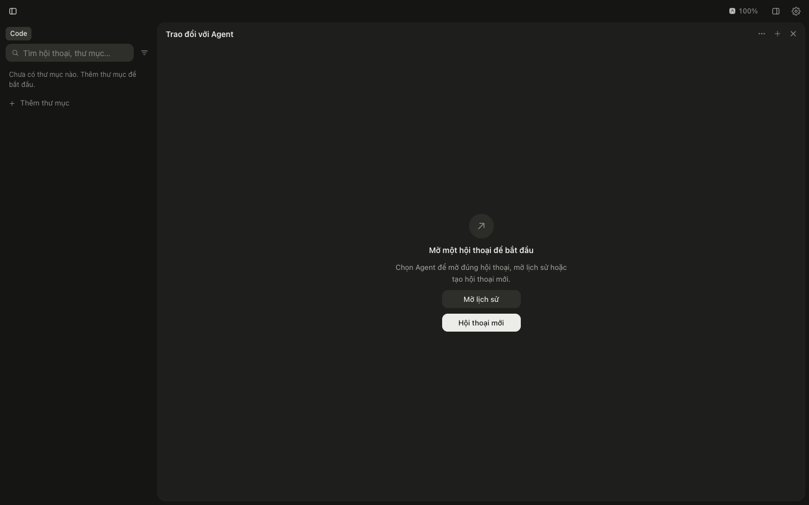
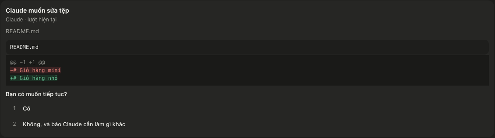

[English](README.md) · [Tiếng Việt](README.vi.md) · [Español](README.es.md) · [Português (Brasil)](README.pt-BR.md) · [Français](README.fr.md) · [Deutsch](README.de.md)

# Agent Workspace

Agent Workspace é um app para macOS que reúne Claude Code, Codex e Antigravity em uma janela, para você ver quais agentes estão trabalhando e quais estão aguardando você.


Baixe a versão mais recente: [Agent-Workspace-arm64.dmg](https://github.com/dat08101999/agent-workspace/releases/latest/download/Agent-Workspace-arm64.dmg) (as outras versões estão na página [Releases](https://github.com/dat08101999/agent-workspace/releases)).

Página inicial, com uma demonstração interativa e um vídeo: https://dat08101999.github.io/agent-workspace/

Este repositório contém apenas documentação, a página inicial (a branch `gh-pages`) e instaladores. O código-fonte do app não está aqui.

## O que o app faz

Você abre vários agentes ao mesmo tempo, cada um trabalhando em uma pasta diferente. Um deles para para perguntar se pode editar um arquivo. Você está em outra janela e não percebe. O agente continua aguardando.

Agent Workspace reúne suas conversas em uma barra lateral. Você vê quais estão em andamento e quais estão aguardando você. Quando precisam de você, o app mostra uma notificação do macOS e um contador no ícone do Dock. Responda no app.

O app usa Claude Code, Codex e Antigravity já instalados e conectados à sua conta no computador. Ele não tem uma conta própria.

## O que você precisa

- Um Mac com Apple silicon.
- `python3` no computador. A versão do Xcode Command Line Tools é suficiente; se não estiver instalada, execute `xcode-select --install` no Terminal.
- Pelo menos uma destas três ferramentas: Claude Code, Codex ou Antigravity. Ela precisa estar instalada e conectada à sua conta.

Você não precisa instalar .NET nem Node. O servidor já vem com o app.

## Instalação

1. Clique no link acima ou acesse Releases e baixe `Agent-Workspace-arm64.dmg`.
2. Abra o DMG e arraste `Agent Workspace` para Applications.
3. Abra `Agent Workspace` em Applications. Na primeira vez, o macOS vai bloquear o app e informar que não é possível verificá-lo.

O app não tem assinatura Apple Developer ID nem foi notarizado pela Apple, por isso o macOS o bloqueia na primeira vez. Para permitir a abertura:

1. Feche o aviso do macOS.
2. Abra Ajustes do Sistema → Privacidade e Segurança.
3. Role até Segurança. Você verá uma mensagem informando que `Agent Workspace` foi bloqueado.
4. Clique em “Abrir Mesmo Assim”. Em vietnamita: Cài đặt hệ thống → Quyền riêng tư & Bảo mật → "Vẫn mở".
5. Quando o macOS pedir, confirme com a senha do Mac ou com Touch ID e abra o app novamente.

Depois disso, abra o app normalmente.

## Primeira abertura

O app encontra Claude Code, Codex e Antigravity no computador e se conecta a eles automaticamente; você não precisa clicar em nada. Confira os resultados em Ajustes → Provedor.

1. Adicione uma pasta. Use “Adicionar pasta” na parte inferior da lista de pastas na barra lateral. Uma pasta no disco funciona como um espaço de trabalho para o app.
2. Abra uma conversa nessa pasta usando o “+” ao lado do nome dela.
3. Escolha onde a conversa será executada (Claude Code, Codex ou Antigravity) e depois escolha um modelo e um nível de esforço.
4. Digite e envie sua primeira mensagem.

Uma nova conversa é um rascunho. O app só cria uma conversa no provedor quando você envia a primeira mensagem.



## Como funciona

O app é uma janela nativa que contém uma página web executada no seu computador. Um pequeno servidor disponibiliza essa página. O próprio app inicia o servidor. Ele escuta apenas em `127.0.0.1` (porta 5188) e se comunica com Claude Code, Codex e Antigravity no computador. Os scripts auxiliares são executados com o `python3` do computador.

```
Janela do app  <->  servidor local 127.0.0.1:5188  <->  Claude Code / Codex / Antigravity
                                                       (no seu Mac)
```

O app não chama nenhuma API de modelos. Cada turno é executado pelas ferramentas do provedor.

## Recursos

### Acompanhar

- A barra lateral mostra quais conversas estão em andamento e quais estão aguardando você (com a marca “!”). O contador `N precisam de você` mostra quantas conversas precisam de você.
- Quando a janela está em segundo plano e um agente faz uma pergunta, o macOS mostra uma notificação e o ícone do Dock exibe o número de conversas aguardando.
- Quando um turno termina, o macOS mostra uma notificação de conclusão. Você pode desativá-la no menu do app, em “Notificar quando o Agent terminar”. As notificações de perguntas continuam ativadas.
- Depois de cada turno, um bloco lista os arquivos editados. Clique em um arquivo para abri-lo na coluna à direita.
- A tela de limites de uso mostra os limites informados por cada provedor.
- Expanda cada etapa de trabalho (executar um comando, editar um arquivo) para ver a saída do comando ou o diff do arquivo.
- Os planos em formato de checklist e o raciocínio disponibilizado pelo provedor aparecem na conversa.
- A interface está disponível em inglês, vietnamita, espanhol, português (Brasil), francês e alemão. Ela segue o idioma do seu Mac; altere em Ajustes → Idioma.
- “Escritório de agentes” é um escritório em pixel art. Cada agente é um personagem cuja pose reflete seu status real: trabalhando à mesa, acenando quando precisa de você, com uma marca de verificação ao terminar e um pequeno robô para um agente filho.

### Aprovar

- As solicitações de permissão de Claude Code, Codex e Antigravity aparecem em cartões. Para edições de arquivos, o cartão mostra as linhas removidas e adicionadas. Em um cartão do Antigravity, "Permitir neste chat" também permite depois o mesmo tipo de comando nesse chat.
- As perguntas e os planos do Claude Code também aparecem ali. No Codex, os cartões também incluem solicitações para executar ferramentas MCP e abrir formulários e páginas.
- As perguntas de um agente filho do Claude em execução em segundo plano também aparecem para você responder.



### Parar

- Você pode parar um turno em andamento.
- Um turno parado recebe a indicação “Este turno foi interrompido.”
- Um turno com falha mostra o motivo informado pelo provedor.

### Continuar

- Envie outra mensagem enquanto um turno está em andamento.
- Recarregue a página sem perder o turno em andamento.
- Cada conversa tem suas próprias opções de runtime (Claude Code, Codex ou Antigravity), modelo e esforço.
- Uma conversa em rascunho não cria nada no provedor até o envio da primeira mensagem.
- Anexe imagens, PDFs e arquivos de texto com os três provedores.
- Edite uma mensagem enviada: a conversa volta para essa mensagem para que você possa enviá-la novamente. Com Claude Code, você também pode optar por restaurar os arquivos editados depois dela.
- Crie uma branch a partir de uma mensagem para tentar outro caminho em uma nova conversa.
- Escolha o modo de permissões no campo de mensagem: por chat para Claude Code e Codex; por pasta para Antigravity (Request Review, Default ou Turbo, salvo nas configurações do Antigravity para esse projeto).
- No Codex: enviar depois (a mensagem aguarda o fim do turno em andamento), modo Plan, revisão e metas.
- Tarefas em segundo plano do Claude Code e Antigravity: veja a saída e pare tarefas individualmente.

### Conectores (servidores MCP)

- No campo de mensagem, “+” → Connector mostra os servidores MCP do provedor usado pela conversa.
- Ative ou desative cada servidor, reconecte um servidor com falha e entre nos servidores que exigem autenticação (Codex, Antigravity).
- No Codex e no Antigravity, as alterações se aplicam a todas as conversas desse provedor no computador, inclusive no app nativo. No Claude Code, elas se aplicam apenas àquela pasta.
- Antes de desativar o servidor `pet_task_manager` do app, ele pergunta novamente, porque a delegação precisa dele.

### Delegar a outro agente

- Em qualquer conversa (Claude Code, Codex ou Antigravity), peça a um agente de outro provedor para fazer algo, por exemplo, “peça ao Codex para revisar este arquivo”. O app abre uma conversa real nesse provedor e envia a tarefa; depois, retorna a resposta para a conversa que fez o pedido.
- Uma conversa delegada fica abaixo da conversa que fez o pedido, atrás do botão “N filhos” na barra lateral, com o rótulo “delegado”. Você pode abri-la e enviar mensagens diretamente.
- Peça um modelo pelo nome conhecido, por exemplo, “Codex sol 6.1”. Se houver vários modelos com esse nome, o agente recebe uma lista para escolher ou pergunta a você.
- Cada conversa pode ter até 3 agentes filhos em execução ao mesmo tempo, e eles não podem criar outros agentes filhos.
- Este recurso vem desativado. Ative-o em Ajustes → Provedor → “Agentes filhos de outros provedores”.

## Dados e privacidade

- O app não tem uma conta própria e não chama nenhuma API de modelos.
- O conteúdo das conversas é enviado pelas suas ferramentas Claude Code, Codex ou Antigravity, não pelo app.
- O servidor local escuta apenas em `127.0.0.1`.
- Os dados do app (um token local, banco de dados e logs) ficam em `~/Library/Application Support/Agent Workspace`.
- Remover uma conversa ou pasta no app não apaga nada no provedor.
- A cada inicialização, o app adiciona uma entrada MCP chamada `pet_task_manager` à configuração de cada ferramenta instalada: `~/.claude.json` (Claude Code), `~/.codex/config.toml` (Codex), `~/.gemini/config/mcp_config.json` (Antigravity). Assim, as conversas podem usar as ferramentas do app, como delegar a outro agente. Antes de gravar, o app faz um backup do arquivo antigo ao lado do original, mantém intacta qualquer entrada `pet_task_manager` adicionada por outra pessoa e não adiciona a entrada novamente se você a remover.
- Fora isso, o app só grava fora da pasta de dados quando você pede. Por exemplo, clicar em “Instalar hook” em “Fonte do status” adiciona um hook de observação a `~/.claude/settings.json` (Claude Code) ou `~/.gemini/config/hooks.json` (Antigravity). “Remover hook”, no mesmo local, remove o hook.

## Limitações atuais

- Agentes filhos em execução no Antigravity não recebem limites de permissão do app: eles seguem o modo do Antigravity da pasta, que você pode mudar no botão Modo do chat. Por padrão, os agentes filhos do Codex são somente leitura.
- No modo de permissões Manual, aparece um cartão de aprovação cada vez que Claude usa a ferramenta de agente filho.
- Ainda não é possível entrar nos servidores MCP do Claude Code pelo app; use `/mcp` no Claude Code.
- Disponível apenas para macOS em Apple silicon.
- O app não tem assinatura Apple Developer ID nem foi notarizado pela Apple, então você precisa seguir as etapas de “Abrir Mesmo Assim” na primeira vez.
- O app foi testado em poucos computadores. Se não abrir, informe o problema em Issues.

## Desinstalação

1. Se você clicou em “Instalar hook” no app, clique primeiro em “Remover hook”. O comando do hook aponta para o local do app e deixará de funcionar se o app for apagado ou movido.
2. Encerre `Agent Workspace`.
3. Arraste `Agent Workspace` de Applications para o Lixo.
4. Remova a entrada `pet_task_manager` de `~/.claude.json`, `~/.codex/config.toml` e `~/.gemini/config/mcp_config.json`. Essa entrada aponta para o app e deixará de funcionar quando ele for apagado.
5. Para remover também os dados do app, apague `~/Library/Application Support/Agent Workspace`.

## Dúvidas e relatos de bugs

Abra um issue em https://github.com/dat08101999/agent-workspace/issues.

Ao relatar um bug, inclua a versão do app, a versão do macOS, o provedor da conversa, as etapas que você seguiu e o que aconteceu. Não cole tokens nem conteúdo confidencial de conversas em um issue.
